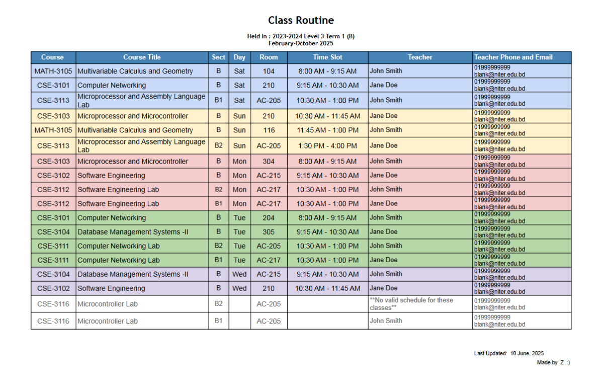

# Automated UCAM Class Routine to Google Sheets

An automated solution for scraping class schedules from the UCAM web portal and synchronizing them with a Google Spreadsheet.

**New here?** Follow the step-by-step bring-up guide in [**SETUP.md**](SETUP.md) — it covers Google Cloud setup, configuration, first run, and automation.

## Final Output Preview



[**Demo Output Spreadsheet**](https://docs.google.com/spreadsheets/d/1mE36dYY9u4rgwbJl9rq8LibBlB-VLd_K3Jli_Db3bxA/edit?usp=sharing)

### Key Features
* **Automated Extraction**: Authenticates with the UCAM portal to retrieve schedule data.
* **Multi-User Consolidation**: Merges schedules from one or more accounts (exactly one `primary`, the rest `lab_merge` for lab-section synchronization).
* **Data Enrichment**: Integrates teacher contact details from local configuration files.
* **Chrome/Chromium Only**: Drives Google Chrome or Chromium over the DevTools protocol (Firefox is not supported).
* **Sheets Integration**: Archives the raw rows to a `backend` tab and writes the sorted routine to `NewMain`, using a service account (no browser login).
* **Advanced Processing**: Normalizes time formats to 12-hour display, sorts chronologically, and stamps a date-only "Last Updated" footer.

---

## Prerequisites

* **Python 3.10+** (developed and tested on 3.14 — ruff enforces 3.10-compatible syntax, so older 3.1x versions are expected to work)
* **pip** (Python package manager)
* **Google Chrome** or **Chromium**
* **Xvfb** (Required for headless Linux environments)
* **Google Account** with enabled access to Google Drive and Google Cloud Platform

---

## Project Structure
```text
project_root/
├── routine_scrapper.py         # Primary scraping logic for UCAM portal
├── gsheet_formatter.py         # Google Sheets API integration
├── routine_format.py           # Sorting / 12-hour formatting / footer stamp
├── config.py                   # Central runtime configuration
├── SETUP.md                    # Step-by-step bring-up guide
├── .env.example                # Environment variable overrides template
├── browser_lookup.py           # Shared Chrome/Chromium binary discovery
├── tests/                      # Unit test suite (pytest)
├── configs_to_edit/            # User configuration directory
│   ├── ucam_login_credentials.json.example.txt
│   └── teacher_contact_details.json.example.txt
├── google_cloud_keys/          # API credentials directory
│   └── service_account_key.json.example.txt
├── scripts/                    # Local automation and helper scripts
│   ├── run_routine.sh          # Runner script (Unix/macOS)
│   ├── run_routine.bat         # Runner script (Windows)
│   ├── verify.sh               # Lint + pytest (verify.bat for Windows)
│   ├── install_hooks.sh        # Optional pre-commit hook running verify.sh
│   ├── setup.py                # Config scaffold + validation
│   ├── check_setup.py          # Online preflight check
│   ├── routine-automation.service.example
│   ├── routine-automation.timer.example
│   └── routine-automation.plist.example
├── output_of_fetched_routine/  # Local cache for scraped data
├── pyproject.toml              # ruff + pytest configuration
├── requirements.txt            # Runtime dependencies (pinned)
├── requirements-dev.txt        # Test/lint dependencies (includes requirements.txt)
└── README.md                   # Documentation
```

---

## Setup

The full walkthrough lives in [**SETUP.md**](SETUP.md): Google Cloud setup (Phase A), local configuration (Phase B), first run (Phase C), and automation (Phase D). A condensed quickstart follows.

Create a virtual environment and install dependencies:

**Unix/macOS:**
```bash
python3 -m venv .venv && source .venv/bin/activate && pip install -r requirements.txt
```

**Windows:**
```powershell
python -m venv .venv; .\.venv\Scripts\activate; pip install -r requirements.txt
```

All commands below use `.venv/bin/python` (Unix/macOS) or `.\venv\Scripts\python.exe` (Windows); the venv need not be activated for them to work.

`requirements.txt` is enough to *run* the pipeline; install `requirements-dev.txt` instead if you also want to run the tests and linter (it includes the runtime dependencies).

Scaffold the config files from templates:

```bash
.venv/bin/python scripts/setup.py
```

Then edit the real files it creates — your UCAM login (`configs_to_edit/ucam_login_credentials.json`) and your `.env`, where you must set `SPREADSHEET_NAME` (exact name of your Google Spreadsheet) and share that spreadsheet with your service account. See **SETUP.md Phase B** for what goes in each.

The formatter auto-creates both worksheets (`backend` and `NewMain`) if they don't already exist. A freshly created `NewMain` gets `SHEET_HEADERS` written to `B3:I3`; the sorted, 12-hour-formatted rows land at `B4`, with the "Last Updated" footer two rows below the data in column I.

The scraper uses **nodriver** (successor of `undetected-chromedriver`) to drive Chrome over the DevTools protocol directly — **no chromedriver is downloaded or version-matched**, so Chrome auto-updates can't break it. The binary is auto-detected (PATH scan on Linux, the well-known `.app` bundle path on macOS, Program Files / `%LOCALAPPDATA%` on Windows). Set `CHROME_BINARY_PATH` in `.env` to force a specific binary (useful when both Google Chrome and Chromium are installed). Chrome-only: Firefox is not supported.

---

## Usage

1. **Scrape Routine**:
   ```bash
   .venv/bin/python routine_scrapper.py
   ```
   *Note: On headless Linux, run via `xvfb-run --auto-servernum --server-args="-screen 0 1920x1080x24" .venv/bin/python routine_scrapper.py`.*
2. **Update Sheets**:
   ```bash
   .venv/bin/python gsheet_formatter.py
   ```
   *Note: no browser step — the service account authenticates silently, so this also works unattended.*

To run both stages in one go, use `scripts/run_routine.sh` (Unix/macOS) or `scripts\run_routine.bat` (Windows).

---

## Testing

Run every check with one command — ruff lint and the python test suite:

```bash
./scripts/verify.sh          # scripts\verify.bat on Windows
```

Install the dev dependencies first (they include the runtime ones):

```bash
.venv/bin/pip install -r requirements-dev.txt
```

The python suite covers dashboard parsing, merge logic, browser workflow steps, sheet-building helpers, the sort/format port, and setup validation:

```bash
.venv/bin/python -m pytest tests/ -q
```

Optional: make these run automatically before each commit (there is no CI — Cloudflare blocks the logged-in scrape from datacenter IPs, so the pipeline is always run locally):

```bash
./scripts/install_hooks.sh            # ./scripts/install_hooks.sh --uninstall to remove
```

---

## Automation

Weekly automation — a systemd timer (Linux), Task Scheduler (Windows), or a launchd agent (macOS) — is documented in **SETUP.md Phase D**.

---

## Verification

Before your first run, run the preflight check:

```bash
.venv/bin/python scripts/check_setup.py
```

It verifies the config files and that your spreadsheet opens with the service account.

---

## Troubleshooting

A troubleshooting table (spreadsheet not shared, missing Chrome binary, Cloudflare blocks, stale output, and more) lives in **SETUP.md**.
